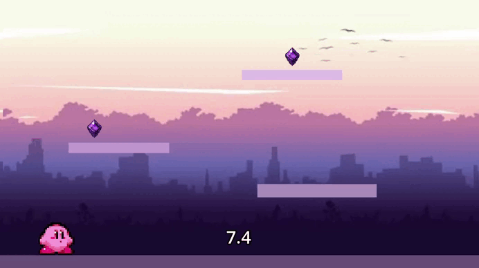
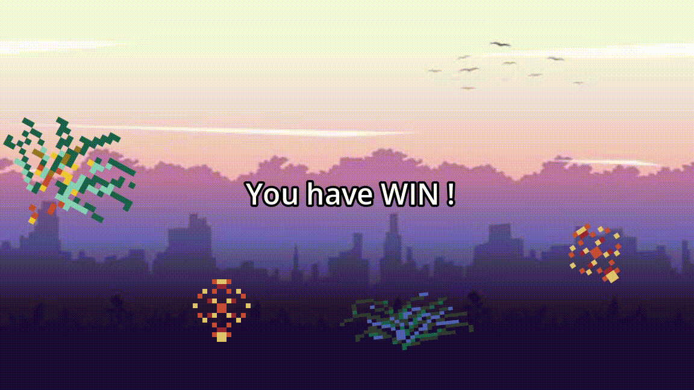
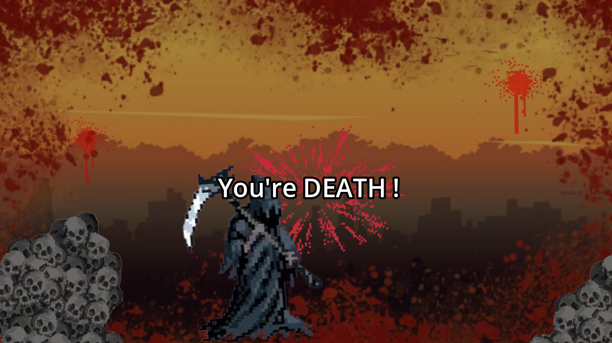

# miniGAME

miniGAME is a Godot game with two mini-games. The first one is a platformer where you collect all the orbs before time runs out, and the second is a clicker where you click every orb also before the timer ends.

# Try it

You can play it [**here**](https://reaue.itch.io/minigame).

# Features

- The game has a background-music which an adjustable volume, changeable in the settings.
- The game include a winning and death screen, which are original.
- The player has 3 lives and the remaining lives are displayed between games
- If the timer runs out before the player finishes a mini-game, they lose one life. When all three lives are gone, the game over screen appears.
***
**The winning screen :**
(With custom animated pixel arts)

***
**The death screen :**

***
### Mini-game 1:
- A platformer where you need to collect all the orbs, during a limitated time, to finish the level.
***
### Mini-game 2:
- A clicker where you need to clicks on every orb, before the end of the timer.

# How to run it locally

1) Install Godot 4.7.2. The exact version is stored in project.godot, so check it there.
2) Clone the repository and open the [`project.godot`](project.godot) file in Godot.
3) Press F5 to run the game.

# How it works 

The game starts in the `Title_scene` screen withe three buttons, the first one, for playing, the second fot the settings and then for quitting the game.

Then between each try for the mini-games, you will see during *2.5s* a screen with your number of lives and the level number.

# Credits

The project uses open source assets which came from the web such as [pixabay's assets](https://pixabay.com/fr/) or other open source pixel arts from the web. 